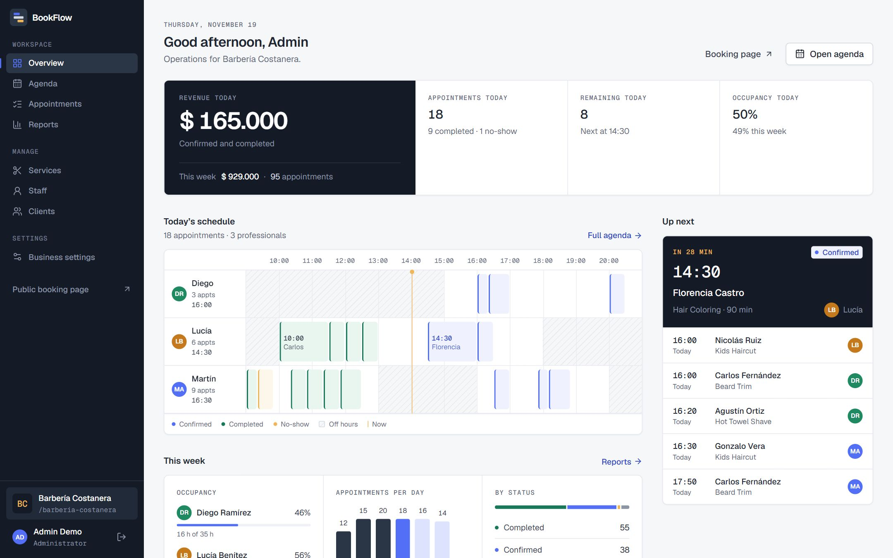
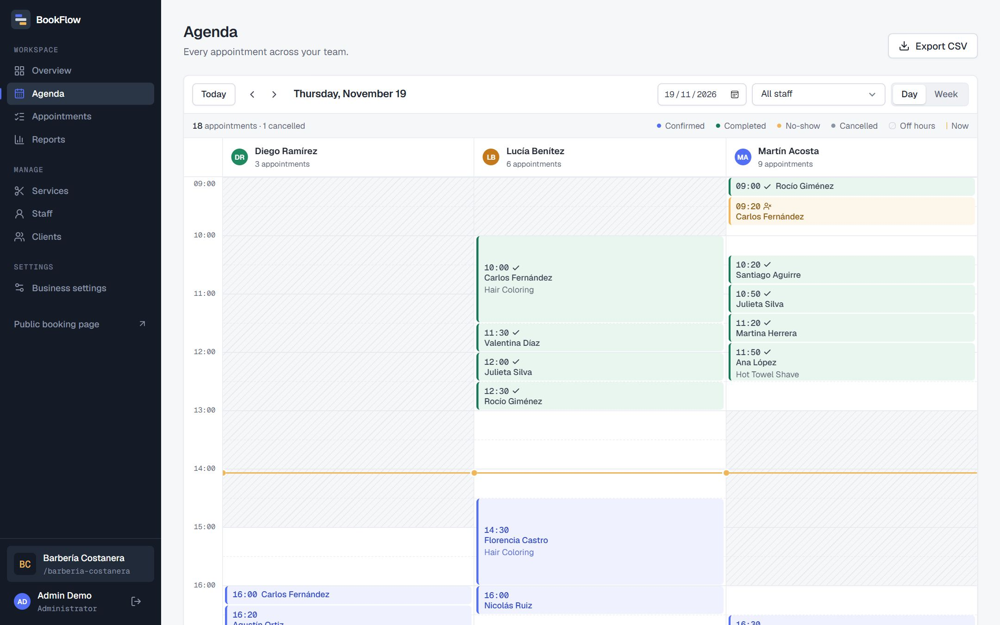
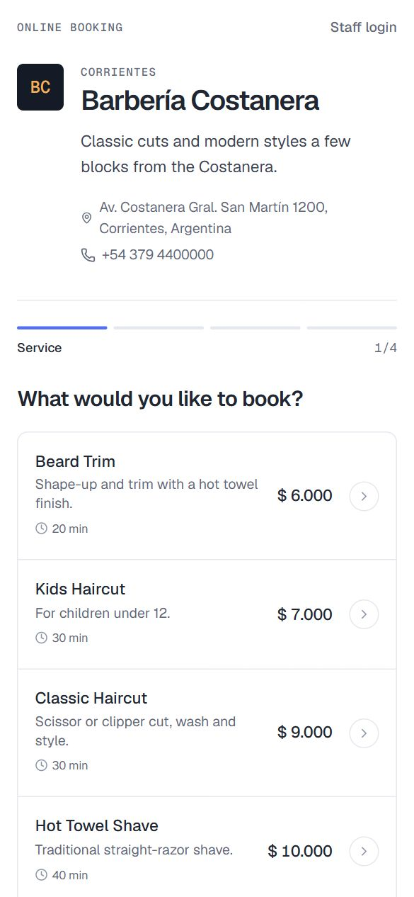
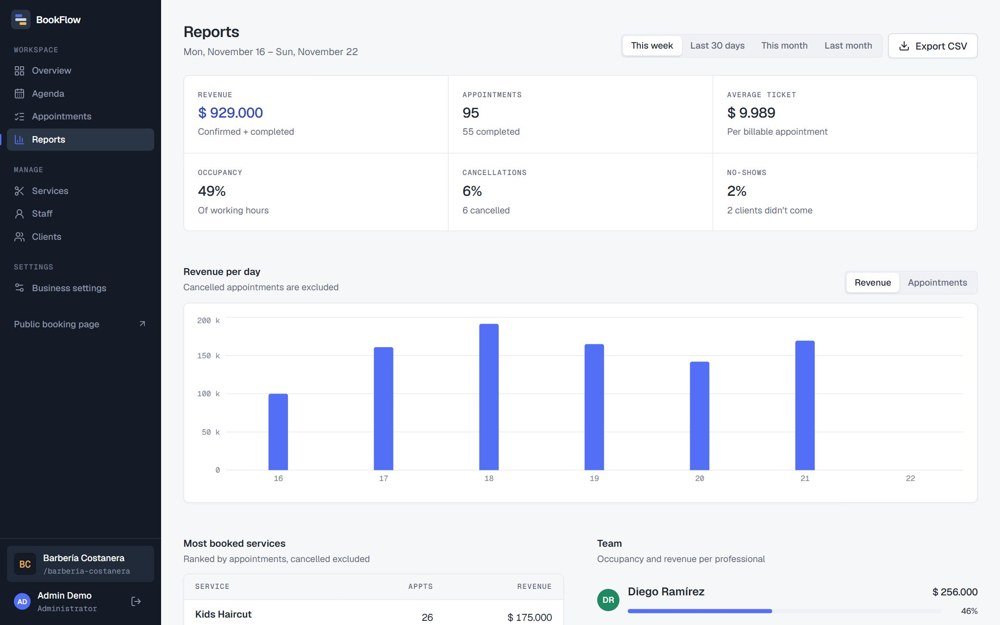
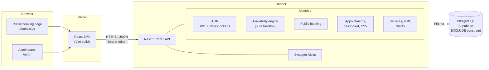

<div align="center">


# BookFlow

**Online booking and appointment management for small businesses: barbershops, clinics, gyms and studios.**

[](https://github.com/lucaswsanchez/bookflow/actions/workflows/ci.yml)
[](LICENSE)


### [🚀 Live Demo](https://bookflow-phi-ivory.vercel.app) &nbsp;·&nbsp; [📘 API Docs (Swagger)](https://bookflow-api-f8qe.onrender.com/docs) &nbsp;·&nbsp; [📋 Project Board](https://github.com/users/lucaswsanchez/projects/2)

</div>

> **Try it in 30 seconds.** Open the [booking page](https://bookflow-phi-ivory.vercel.app/book/barberia-costanera) and book
> an appointment, open the [admin demo in one click](https://bookflow-phi-ivory.vercel.app/login?demo=admin),
> or [log in](https://bookflow-phi-ivory.vercel.app/login) with a demo account:
>
> | Role  | Email            | Password    | Can do |
> | ----- | ---------------- | ----------- | ------ |
> | Admin | `admin@demo.com` | `Admin123!` | Everything |
> | Staff | `staff@demo.com` | `Staff123!` | Only their own agenda |
>
> ⏳ The API runs on Render's free tier: **the first request may take ~50s (free tier cold start)**.



| Agenda (day view, one column per professional) | Public booking on a phone |
| --- | --- |
|  |  |



## Features

**For clients (no account needed)**
- Mobile-first booking in 4 steps: service → professional → day and time → details.
- Only real availability is shown. It is calculated on the server from each professional's weekly
  hours, the service duration and existing bookings.
- Each booking gets a confirmation code (e.g. `BF-7K3P9Q`) and an "Add to calendar" (.ics) file.
- The page is built from the business's own data (name, description, address, phone), so a
  clinic, a tattoo studio or a gym gets its own booking page without new UI.

**For the business (admin panel)**
- Overview: revenue and appointments for today and this week, next appointments, status
  breakdown and occupancy per professional.
- Agenda: day view (one column per professional) and week view on a time grid, with working vs.
  off hours, overlapping appointments side by side, status colors and a current-time line.
- Appointments list with search (client, phone, service, code) and filters by period, status and
  professional.
- Reports: revenue per day, average ticket, occupancy, cancellation and no-show rates, most booked
  services and results per professional.
- Mark appointments as completed, no-show, cancelled or confirmed.
- Export appointments to CSV (Excel-friendly).
- Manage services (duration, price in ARS), staff (services offered and weekly hours with split
  shifts) and clients (search by name, phone or email).

**Under the hood**
- JWT auth with short-lived access tokens and rotating refresh tokens; `ADMIN` and `STAFF` roles.
- STAFF users can only see and manage their own agenda, enforced on the server.
- No double bookings: a PostgreSQL exclusion constraint plus transactional re-validation.
- Login rate limiting, input validation, and a consistent JSON error format.
- REST API documented with OpenAPI/Swagger.
- Custom design system (tokens, components and a `/app/ui` showcase page) with a responsive,
  accessible UI: loading, error and empty states, and stable `data-testid` attributes for E2E tests.
- Admin screens are lazy-loaded so the public booking page stays light on phones.

## Tech Stack

| Layer | Technology |
| --- | --- |
| Frontend | React 19, TypeScript, Vite, Tailwind CSS 4, TanStack Query, React Hook Form, Zod, React Router, Recharts, Lucide |
| Backend | NestJS 11, TypeScript, Prisma ORM, class-validator, JWT, @nestjs/throttler, Luxon, Swagger |
| Database | PostgreSQL (Supabase in production) |
| Testing | Jest, Supertest, Vitest, Testing Library |
| DevOps | GitHub Actions, Docker & Docker Compose, Render (API), Vercel (web), pnpm workspaces |

## Architecture



- [Data model (ER diagram)](docs/data-model.md)
- [Technical decisions](docs/technical-decisions.md)

### Project structure

```
bookflow/
├── apps/
│   ├── api/                  # NestJS REST API
│   │   ├── prisma/           # schema, versioned migrations, deterministic seed
│   │   ├── src/
│   │   │   ├── auth/         # login, refresh, guards
│   │   │   ├── availability/ # availability engine + service
│   │   │   ├── public/       # booking endpoints (no auth)
│   │   │   ├── appointments/ # agenda, status, dashboard, CSV
│   │   │   ├── services/  staff/  clients/
│   │   │   └── common/       # decorators, error filter
│   │   └── test/             # e2e tests (Supertest)
│   └── web/                  # React + Vite SPA
│       └── src/{pages,components,auth,lib}
├── docs/                     # ER diagram, technical decisions, screenshots
├── .github/workflows/ci.yml
├── docker-compose.yml
└── render.yaml               # Render Blueprint
```

## Getting Started

### Prerequisites
- Node.js 20+ and pnpm 9 (`corepack enable`)
- A PostgreSQL database (local, Docker, or a free [Supabase](https://supabase.com) project)

### Option A: Docker (everything included)

```bash
docker compose up --build
```

- Web: http://localhost:5173
- API: http://localhost:3000 (Swagger at http://localhost:3000/docs)

Migrations and the demo seed run automatically when the API container starts.

### Option B: Without Docker

```bash
git clone https://github.com/lucaswsanchez/bookflow.git
cd bookflow
pnpm install

# API
cp apps/api/.env.example apps/api/.env   # set DATABASE_URL / DIRECT_URL / JWT_ACCESS_SECRET
pnpm --filter api db:migrate
pnpm --filter api db:seed

# Web
cp apps/web/.env.example apps/web/.env

# Run both
pnpm dev
```

## Environment Variables

**API** (`apps/api/.env`)

| Variable | Description | Example |
| --- | --- | --- |
| `DATABASE_URL` | Runtime connection (Supabase: transaction pooler, port 6543, `?pgbouncer=true`) | `postgresql://…:6543/postgres?pgbouncer=true` |
| `DIRECT_URL` | Connection for migrations (Supabase: session pooler, port 5432) | `postgresql://…:5432/postgres` |
| `JWT_ACCESS_SECRET` | Secret used to sign access tokens | long random string |
| `JWT_ACCESS_TTL` | Access token lifetime in seconds | `900` |
| `REFRESH_TOKEN_TTL_DAYS` | Refresh token lifetime in days | `7` |
| `CORS_ORIGINS` | Comma-separated allowed frontend origins | `http://localhost:5173` |
| `LOGIN_RATE_LIMIT` | Login attempts per IP per minute | `10` |
| `PORT` | HTTP port | `3000` |

**Web** (`apps/web/.env`)

| Variable | Description | Example |
| --- | --- | --- |
| `VITE_API_URL` | Base URL of the API | `http://localhost:3000` |

## Running Tests

```bash
# API unit tests (availability engine, guards, validation)
pnpm --filter api test

# API e2e tests: needs a disposable PostgreSQL database in DATABASE_URL/DIRECT_URL
pnpm --filter api test:e2e

# Web component and unit tests
pnpm --filter web test

# Everything CI runs
pnpm lint && pnpm typecheck && pnpm test && pnpm build
```

| Suite | Tool | Tests |
| --- | --- | --- |
| API unit | Jest | 37 (19 for the availability engine, ~97% line coverage) |
| API e2e | Jest + Supertest + PostgreSQL | 33 (auth, roles, CRUD, booking race condition, CSV) |
| Web | Vitest + Testing Library | 26 (booking and login components, metrics, periods, agenda layout, dates, .ics) |

CI runs every suite on each pull request, with a PostgreSQL 16 service container for the e2e tests.

## Project Management

The project was planned and built with an agile workflow on GitHub:

- **[Kanban board](https://github.com/users/lucaswsanchez/projects/2)** with Backlog / In progress / Done columns.
- **19 user stories** written as issues ("As a … I want … so that …"), each with acceptance criteria
  as a checklist, labels (`feature`, `test`, `docs`, `ci`) and a milestone (**MVP** or **Polish**).
- **One branch and one pull request per story**, with Conventional Commits (`feat:`, `test:`,
  `docs:`, `ci:`). Each PR closes its issue with `Closes #N` and is squash-merged after CI passes.

## Roadmap

- [ ] Email / WhatsApp confirmations and reminders
- [ ] Clients can cancel or reschedule with their confirmation code
- [ ] Online payments and deposits (Mercado Pago)
- [ ] Multi-business onboarding (sign-up flow; the data model is already scoped by business)
- [ ] Holidays and one-off schedule exceptions per staff member
- [ ] "Any professional" option when booking
- [ ] Typed API client generated from the OpenAPI spec
- [ ] Rate limiting on the public booking endpoint
- [ ] Per-business accent color and logo upload

## Lessons Learned / Technical Decisions

1. **Business rules belong in pure functions.** The availability engine has no I/O and receives
   `now` as a parameter. That made 19 edge cases (split shifts, back-to-back bookings, partial
   overlaps, time zones) quick to test and safe to refactor.
2. **Let the database guarantee invariants.** Checking availability in code still leaves a race
   window. A PostgreSQL `EXCLUDE` constraint makes overlapping bookings impossible, and an e2e
   test fires two concurrent bookings to prove it (one `201`, one `409`).
3. **Time zones are a domain concern.** Appointments are stored in UTC, but "today", weekdays and
   working hours are always computed in the business's time zone. A server in UTC would otherwise
   offer Tuesday 21:00 slots on Wednesday.
4. **Secure by default.** Global auth and role guards protect every endpoint unless it's
   explicitly `@Public()`. STAFF scoping is enforced in the query, not just in the UI.
5. **Rotating refresh tokens over long-lived JWTs.** Short access tokens keep requests stateless.
   Hashed, single-use refresh tokens allow logout and limit the damage of a leaked token.

More detail in [docs/technical-decisions.md](docs/technical-decisions.md).

## Author

**Lucas Sanchez**: Systems Analyst from Corrientes, Argentina.

- LinkedIn: [linkedin.com/in/lucaswsanchez](https://www.linkedin.com/in/lucaswsanchez)
- GitHub: [@lucaswsanchez](https://github.com/lucaswsanchez)
- Portfolio: [lucassanchez.netlify.app](https://lucassanchez.netlify.app)

## License

[MIT](LICENSE)
