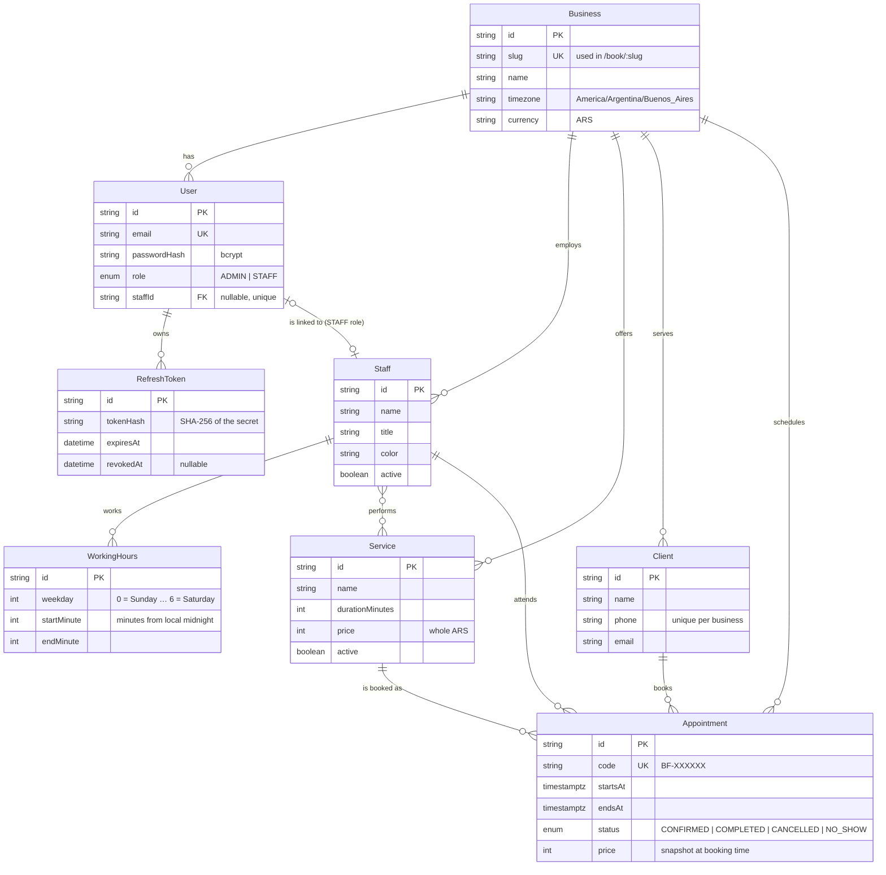

# Data model

BookFlow stores everything in PostgreSQL through Prisma. The schema lives in
[`apps/api/prisma/schema.prisma`](../apps/api/prisma/schema.prisma) and every change is a
versioned migration in [`apps/api/prisma/migrations`](../apps/api/prisma/migrations).

## Integrity rules enforced by the database

| Rule                                                          | How                                                                                                                                     |
| ------------------------------------------------------------- | --------------------------------------------------------------------------------------------------------------------------------------- |
| A staff member can't have two overlapping active appointments | `EXCLUDE USING gist ("staffId" WITH =, tstzrange("startsAt","endsAt",'[)') WITH &&) WHERE (status <> 'CANCELLED')` (needs `btree_gist`) |
| An appointment must end after it starts                       | `CHECK ("endsAt" > "startsAt")`                                                                                                         |
| One client per phone number per business                      | `UNIQUE (businessId, phone)`                                                                                                            |
| Confirmation codes are unique                                 | `UNIQUE (code)`                                                                                                                         |
| History is never orphaned                                     | `ON DELETE RESTRICT` from appointments to staff, service and client; the API deactivates instead of deleting                            |

Time ranges are half-open (`[start, end)`), so back-to-back appointments (10:00–10:30 and
10:30–11:00) are allowed.
